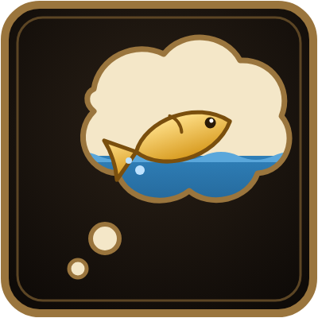
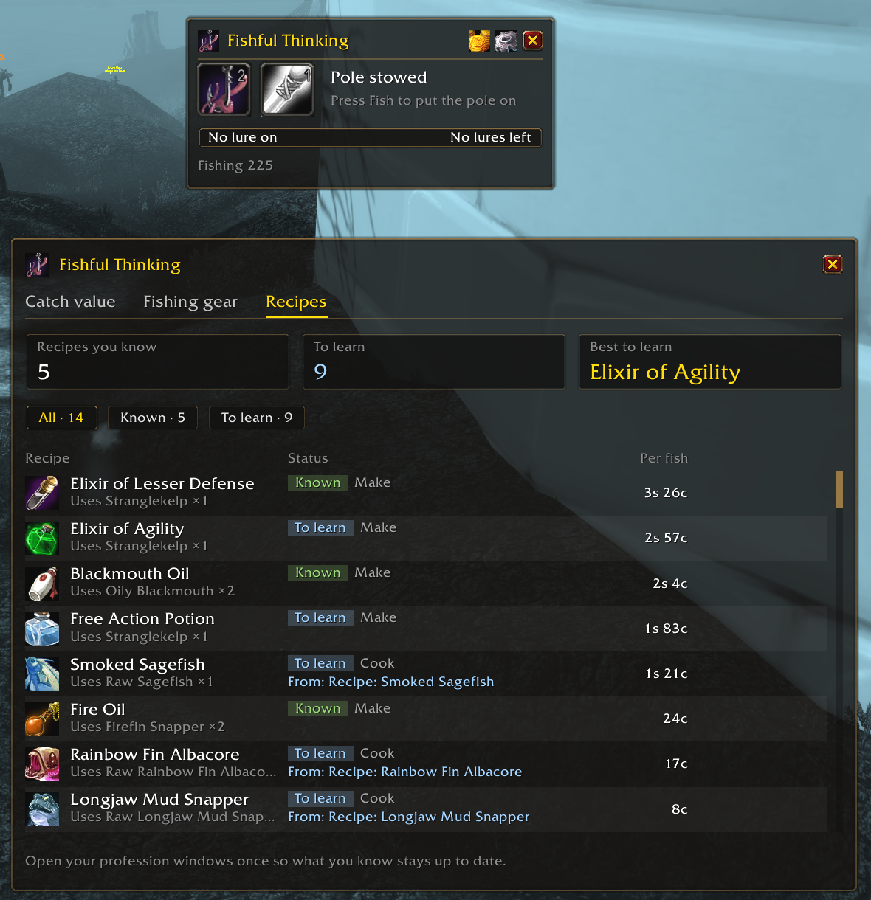
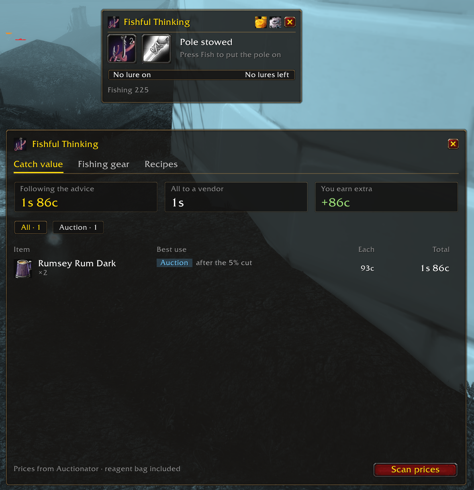
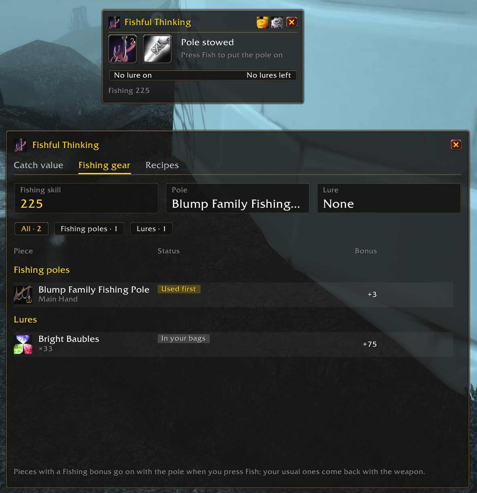
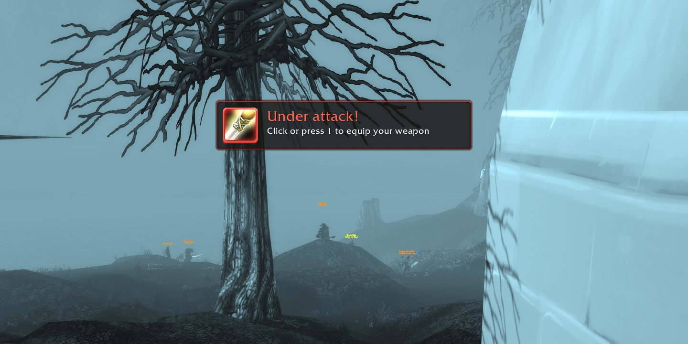
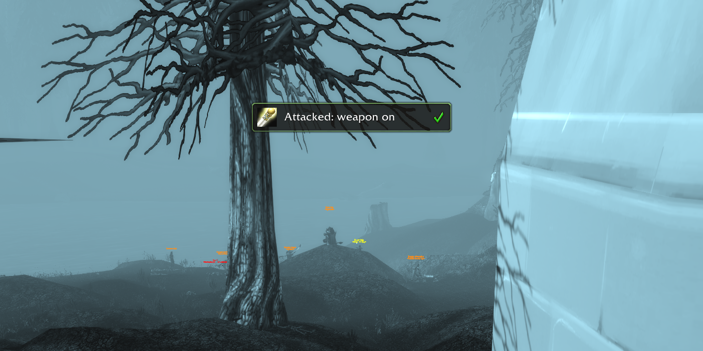
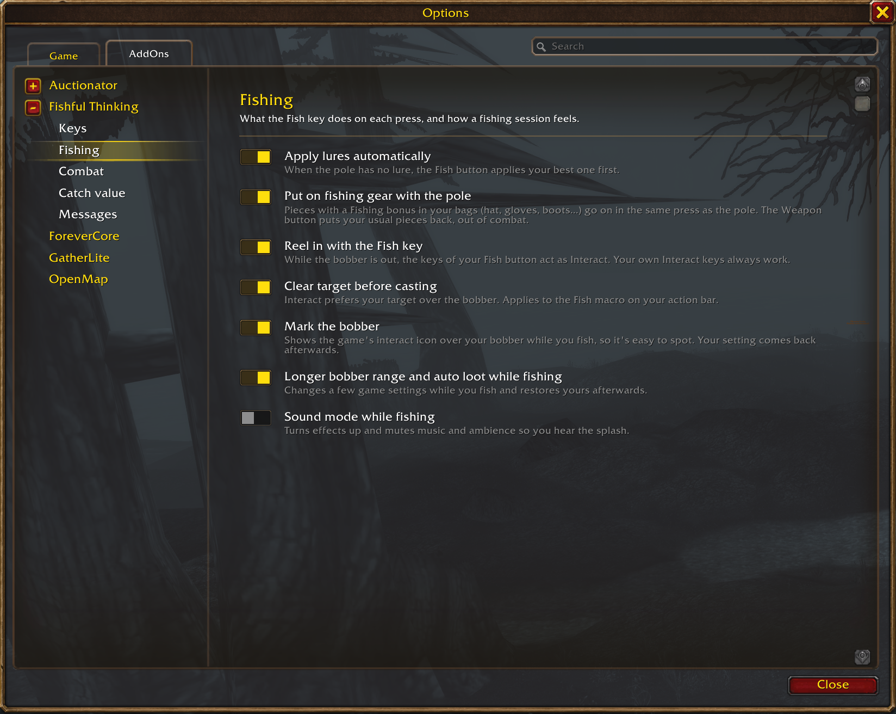
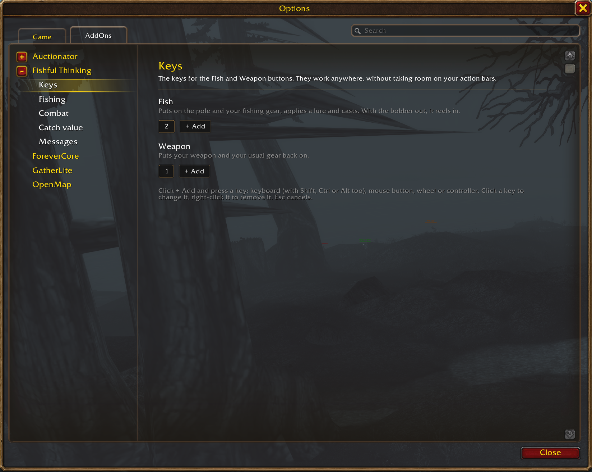

# Fishful Thinking

**One key to fish in World of Warcraft: Forever.** Press it and your pole goes on (with your fishing hat, gloves and boots), the best lure goes on the pole, and you cast. With the bobber out, the same key reels in. When you're done, or when something attacks you, your weapon comes back.

It also tells you what your catch is worth, and what to do with it.

**Download:** [CurseForge](https://www.curseforge.com/wow/addons/fishful-thinking) (WoW: Forever, game version 1.60.1)

## Features

- **One key for everything.** Each press does the next step: equip the pole and your fishing gear, apply the best lure in your bags, cast. While the bobber is out, the same key reels in. Your own Interact key always works too.
- **Your weapon back.** One key puts your weapon and your usual gear back on. If combat starts while you hold the pole, the weapon goes back on by itself. A small notice confirms it. If the game doesn't allow that, a card with your weapon appears: click it or press your Weapon key.
- **Fishing HUD.** Shows only while you hold the pole:
  - The Fish and Weapon buttons with their keys.
  - What to press next.
  - A lure timer.
  - Your Fishing skill with its bonus.
  - Whether fish get away in this water.
  - What you just caught, rising over the HUD.
- **Catch value** (needs [Auctionator](https://www.curseforge.com/wow/addons/auctionator)). For everything you fish, it finds the best use: sell it to a vendor, sell it at the auction house, cook it, or make something with any of your professions. It also tells you about recipes worth learning. You see this in item tooltips, in the chat when you catch something, and in the window.
- **One window, three tabs:**
  - **Catch value:** totals plus a list you can filter.
  - **Fishing gear:** poles, lures and pieces with a Fishing bonus.
  - **Recipes:** every recipe that uses what you fish, known or still to learn.
- **Fishing comfort:**
  - Marks the bobber.
  - Longer bobber range and auto loot while fishing.
  - A sound mode so you hear the splash.
  - Explains why a fish got away.
  - Warns you when your lure runs out.
- **Five languages:** English, Español, Deutsch, Français and Português (English by default; change it in the options or with `/fishful language`).

## Screenshots

| Catch value | Fishing gear |
| --- | --- |
|  |  |
| **Combat alert** | **Weapon back on by itself** |
|  |  |
| **Options: Fishing** | **Options: Keys** |
|  |  |

## Install

With the CurseForge app, search for **Fishful Thinking** under WoW: Forever. To install by hand, unzip the release into `World of Warcraft\_forever_\Interface\AddOns` so you get an `AddOns\FishfulThinking` folder.

## How to use it

1. Set your keys in **Options → AddOns → Fishful Thinking → Keys**, or drag the Fish and Weapon buttons from the HUD to your action bars.
2. Press **Fish** until you cast: each press does the next step (pole, lure, cast). Press it again to reel in.
3. Press **Weapon** when you're done.

### Commands

| Command | What it does |
| --- | --- |
| `/fishful` | Show or hide the HUD |
| `/fishful options` | Open the options |
| `/fishful value` | Open the window on Catch value |
| `/fishful gear` | Open the window on Fishing gear |
| `/fishful recipes` | Open the window on Recipes |
| `/fishful reset` | Center the HUD |
| `/fishful minimap` | Show or hide the minimap button |
| `/fishful tweaks` | Turn bobber range and auto loot while fishing on or off |
| `/fishful sound` | Turn sound mode on or off |
| `/fishful language en\|es\|de\|fr\|pt\|auto` | Set the addon's language |
| `/fishful help` | List the commands |

The commands also work in each language (`/fishful valor`, `/fishful equipo`, `/fishful recetas`…).

## Credits

- Cooking recipes of the Forever client: [Forever Chef](https://github.com/swiftyPigeon/ForeverChef_AddOn) by swiftyPigeon (MIT).
- What can be fished up in Forever, and the recipes that use it: [OneCast](https://github.com/rynmon/OneCast) by rynmon (MIT).
- Auction prices: [Auctionator](https://www.curseforge.com/wow/addons/auctionator) (optional).

## License

MIT © 2026 T&G Alphalabs. See [LICENSE.txt](LICENSE.txt), which also carries the licenses of the data above.
